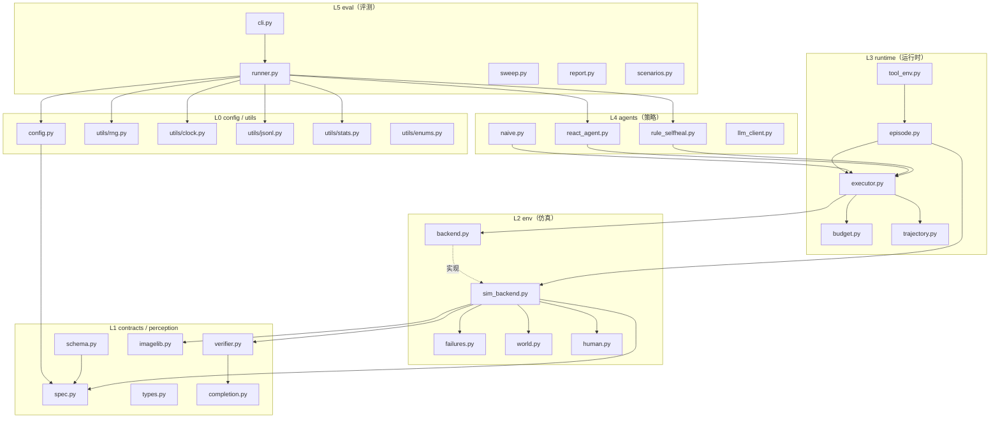

# shelf-agent · 螺丝装箱 → 搬运上架的仿真环境与异常自愈 agent

一个**纯 Python、离线可跑**的仿真环境（带可配置、可复现的故障注入），以及能在其中
**异常自愈**的 agent 骨架。

- 一号机器人（固定）把螺丝装进箱子：阻塞、不可中断，只返回 `done` / `timeout`。
- 一号机器人的头部相机能看到箱内，用来判断螺丝是否装满。
- 二号机器人（可移动）把箱子搬到货架：同样阻塞、不可中断。
- 巡检机器人占位；机器人可单独或整体 `reset`（回初始位姿），不会失败。

本仓库提供：确定性规则策略（baseline）、LLM ReAct agent（tool calling，测试里用脚本化
LLM）、评测工具（批量运行 / 指标 / 故障率扫描 / 出图）、以及扎实的离线 pytest 单测。

---

## 1. 快速开始

```bash
uv sync --extra dev          # 首次安装依赖（uv 不可用时见 §8）
uv run pytest -q             # 全量离线单测
uv run python -m shelf_agent.eval.cli demo --scenario stuck_once --show-truth
uv run python -m shelf_agent.eval.cli sweep --config configs/real_screw.yaml --seeds 100 --failure-rates 0,0.05,0.1,0.2,0.3 --policies naive,retry_only,rule_oracle,rule_noisy --out results/
```

### 组会演示（3 条命令 + 2 张图）

```bash
# ① 机器人卡住 → reset → 补装 → 上架（时间线里能看到 [注入] STUCK 这类真值标注）
uv run python -m shelf_agent.eval.cli demo --scenario stuck_once --show-truth

# ② 搬运「静默失败」：carry 返回 done，但箱子还在工位；POST_CHECK 靠再验证一次发现
uv run python -m shelf_agent.eval.cli demo --scenario carry_silent_fail_detected --show-truth

# ③ 验证器误报完成 → 策略把不完整的箱子搬上货架 → FALSE_FINISH
uv run python -m shelf_agent.eval.cli demo --scenario verifier_false_positive --show-truth
```

- **图 1**：`results/success_vs_failure_rate.png`——左图是成功率随故障注入率的变化（Wilson 区间），
  右图是误放行与不安全放行比例。**想说明的是**：不做自愈的 `naive` 会随故障率崩掉，
  而「重试 + 验证 + 求助」这条链路几乎不受影响；代价是时间。
  逐个图元的读法见 §7.1「怎么看 `success_vs_failure_rate.png`」。
- **图 2**：`results/verifier/verifier_sweep.png`——误放行率随**验证器噪声档位**的变化。
  **想说明的是**：验证器质量是端到端成功率的独立风险来源，规则策略挡不住「误报完成」，
  这一点在 §7.1 的默认噪声下（100 seed）看不出来。

---

## 2. 架构



**依赖方向只能向下**（`L5 → L4 → L3 → L2 → L1 → L0`），由 `tests/test_architecture.py`
用 AST 扫描强制执行：

- `env` / `contracts` / `perception` / `runtime` 不得 import 任何 LLM 或网络库；
- `agents` 不得 import `env.*`（只能经 `ToolExecutor` 与契约类型交互）；
- `contracts` 与 `perception` 同层互不 import（共享枚举因此下沉到 `utils/enums.py`）；
- 库代码里除 `llm_client.py` 的可注入退避外无 `time.sleep`；除 `cli.py` / `report.py` 外无 `print(`。

### 目录

```
shelf_agent/
├── pyproject.toml            # uv + src 布局；依赖仅 pyyaml / pillow / matplotlib / pytest 系
├── README.md
├── configs/
│   ├── real_screw.yaml       # 与真机对齐：1 箱 1 槽，工具无参数
│   └── extended.yaml         # [可] 2 箱 2 槽，带 box_id / slot_id
├── docs/
│   ├── assumptions.md        # 默认假设清单（A1–A26）
│   └── open_questions.md     # 开放问题 Q1–Q13
├── src/shelf_agent/
│   ├── config.py             # L0 配置加载 / 规范化哈希 / LLM 环境变量
│   ├── utils/                # L0 rng / clock / jsonl / stats / enums
│   ├── contracts/            # L1 spec / types / schema（契约校验 + OpenAI schema）
│   ├── perception/           # L1 completion / imagelib / verifier
│   ├── env/                  # L2 world / failures / human / backend / sim_backend
│   ├── runtime/              # L3 executor / budget / trajectory / episode / tool_env
│   ├── agents/               # L4 policy / naive / rule_selfheal / llm_client / react_agent / prompts
│   └── eval/                 # L5 runner / metrics / scenarios / sweep / report / cli
├── scripts/
│   └── live_probe.py         # 真实 LLM 探针（默认关闭，需显式开关）
└── tests/                    # 15 个测试文件，全部离线
```

---

## 3. 工具表

工具名用下划线（OpenAI 兼容 API 不允许函数名含点）；YAML 里保留 `lab_name` 与实验室名称对照。

| 工具名 | 实验室名 | 参数 | status | data | 说明 |
|---|---|---|---|---|---|
| `robot1_install_screws` | `robot1.install_screws` | 无 | `done` / `timeout` | 无 | 阻塞、不可中断；语义为「补装到目标数 N」 |
| `robot1_get_head_image` | `robot1.get_head_image` | 无 | `ok` | `image_id`, `path` | 只返回图像引用，1 s |
| `verify_box` | （本项目新增） | 无 | `ok` / `error` | `inside`, `outside`, `clear` | 拍照 → 验证器；箱子不在工位时 `error` |
| `robot2_carry_box` | `robot2.carry_box` | 无 | `done` / `timeout` | 无 | 阻塞、不可中断 |
| `reset` | `reset` | `robot ∈ {robot1, robot2, all}` | `ok` | 无 | 永不失败 |
| `inspector_run` | `inspector.run` | 无 | `done` | `box_on_shelf`（仅 `shelf_status`） | 默认 `noop` |
| `ask_human` | （本项目新增） | `question: str` | `ok` / `error` | `answer` | 有延迟与配额 |
| `finish` | （本项目新增） | `success: bool`, `summary: str` | `ok` | 无 | 结束 episode |

约定：`status` 取 `done`/`timeout`（实验室技能）、`ok`（其余）、`error`（守卫或前置违规，带
`error_code`）。**install / carry 的返回只有 status 与耗时，不带任何状态信息**——箱子到底搬没搬
成功，只能靠再验证一次来推断（这正是 `POST_CHECK` 存在的理由）。

**message 也只取决于 status**（A27）：物理技能 `done → "done"`、`timeout → "timeout"`；
`reset` / `verify_box` 成功 / `finish → "ok"`；`inspector_run → "done"`。例外只有两处：
`BOX_NOT_AT_STATION` 的文案（相机直接观察到的事实）与 `ask_human` 的回答（人说的话）。
**文案里不出现任何隐藏状态**（装没装满、散没散落、箱子在哪）——否则 agent 能从 message 里
读出故障，「必须验证才能发现隐藏故障」这个实验前提就没了。
守卫：`tests/test_observation_invariance.py`（同一 status 下不同隐藏状态产生逐字相同的观测）
与 `tests/test_no_leak.py::test_policy_only_sees_allowed_messages`（文案白名单）。

---

## 4. 故障表

每个技能一条**独立随机流**（`sha256(f"{seed}:{stream}")` 派生），保证「换策略不会改变某技能
第 n 次调用的故障命运」。**这条不变量靠「每次调用抽取的随机数个数固定」保证**（A28）：故障模型
每次无条件抽 3 个均匀随机数、验证器每次无条件抽 5 个，分支只决定怎么用、不决定抽几个；否则
同一条流的后续位置会依赖上下文。守卫：`tests/test_random_stream_purity.py`。

| 故障类型 | 触发技能 | 语义 | 权重（默认） |
|---|---|---|---|
| `STUCK` | install | 装到一半卡住；robot1 → FAULT；返回 `timeout` | 0.4 |
| `INCOMPLETE` | install | 装少了（`progress` 颗）；返回 `done`（**看起来成功**） | 0.4 |
| `STRAY` | install | 最后一颗掉在箱外：箱内 N−1、箱外 1；返回 `done` | 0.2 |
| `TIMEOUT` | carry | robot2 → FAULT；箱子以概率 `p_lost` 变 `LOST`，否则留在工位；返回 `timeout` | 0.5 |
| `SILENT_FAIL` | carry | 返回 `done`，但箱子**仍在工位**（没有观察通道的失败） | 0.5 |

全局旋钮 `failures.rate = 0.15`（扫描时覆盖），`p_lost = 0.3`。

**脚本化注入**（测试与演示的基础）：

```python
FailureModel.scripted({
    "robot1_install_screws": ["STUCK", None, ("INCOMPLETE", {"progress": 2})],
    "robot2_carry_box": [("TIMEOUT", {"lost": False})],
})
```

按调用顺序消费，`None` 表示无事件，字符串是默认参数简写；脚本耗尽后该技能恢复正常。

---

## 5. 自愈流程


两条硬规则（有用例保证）：

1. **验证器没报告 complete，就绝不调用 carry**——`CARRY` 只能从一次「完整」的验证报告进入。
   `tests/test_policies.py` 用 200 seed × 3 个故障率 × 噪声验证器做 property 测试守住这条。
2. **任一限额耗尽 → 先求助人类（还有配额时），否则诚实 `finish(False)`**——宁可失败，也不谎报成功。

限额（`configs/real_screw.yaml` 的 `rule_policy` 段）：
`max_install_calls=6`、`max_resets_per_robot=3`、`max_unclear_retries=2`、
`max_carry_attempts=3`、`max_human_asks=2`。

### 命名场景（测试与演示共用）

| 场景 | 脚本 | 期望 | 实际调用序列 |
|---|---|---|---|
| `happy` | 无故障 | SUCCESS | install → verify → carry → verify → finish |
| `stuck_once` | install:[STUCK] | SUCCESS | install → reset → install → verify → carry → verify → finish |
| `incomplete_topup` | install:[INCOMPLETE(progress=3)] | SUCCESS | install → verify → install → verify → carry → verify → finish |
| `stray_needs_human` | install:[STRAY] | SUCCESS | install → verify → ask_human → verify → carry → verify → finish |
| `carry_timeout_reset` | carry:[TIMEOUT(lost=False)] | SUCCESS | install → verify → carry → reset → verify → carry → verify → finish |
| `carry_silent_fail_detected` | carry:[SILENT_FAIL] | SUCCESS | install → verify → carry → verify → carry → verify → finish |
| `lost_box_needs_human` | carry:[TIMEOUT(lost=True)] | SUCCESS | install → verify → carry → reset → verify → ask_human → verify → carry → verify → finish |
| `stuck_forever` | install:[STUCK]×10 | SAFE_ABORT | install → reset → install → reset → install → reset → install → ask_human → verify → install → ask_human → verify → install → finish |
| `verifier_false_positive` | install:[STRAY] + 验证器误报 complete | FALSE_FINISH（`unsafe_release=True`） | install → verify → carry → verify → finish |

---

## 6. 评测与指标

| Outcome | 条件 |
|---|---|
| `SUCCESS` | `finish(True)` 且真值成功（箱子在 SHELF 且 `inside == N and outside == 0`） |
| `FALSE_FINISH` | `finish(True)` 但真值未成功（**谎报成功**） |
| `SAFE_ABORT` | `finish(False)` 且真值未成功（**诚实失败**） |
| `MISSED_SUCCESS` | `finish(False)` 但真值成功（做对了却不敢报） |
| `ABORTED_BUDGET` | 预算硬停 |
| `MAX_STEPS` | 达到最大步数仍未 finish |
| `AGENT_ERROR` | agent 连续无有效 tool call |

每个 episode 的指标：`outcome`、`makespan_s`（虚拟时钟终值）、各工具调用数、`n_timeouts`、
`n_resets`、`n_unnecessary_resets`、`n_wasted_calls`、`n_human_asks`、`n_invalid_calls`、
`unsafe_release`。聚合时比例给 **Wilson 95% 置信区间**，均值给标准误；**同一组 seed 跑所有
策略**（配对比较，见 `summary.md` 末尾）。

---

## 7. 真实 sweep 结果

以下数字**全部来自实际运行**（命令与 seed 数一并给出，可复现）。

### 7.1 故障率扫描

```bash
uv run python -m shelf_agent.eval.cli sweep --config configs/real_screw.yaml --seeds 100 --failure-rates 0,0.05,0.1,0.2,0.3 --policies naive,retry_only,rule_oracle,rule_noisy --out results/
```

> 写成一行而不是用 `\` 续行，是为了能直接粘进 **PowerShell / cmd**——那两个 shell 不认 bash 的
> `\` 续行符。上面这个命令约 3 秒跑完（2000 个 episode），现场跑比贴图有说服力。

配置：`configs/real_screw.yaml`（N=6，故障权重 STUCK 0.4 / INCOMPLETE 0.4 / STRAY 0.2，
carry TIMEOUT 0.5 / SILENT_FAIL 0.5，`p_lost=0.3`）。每个故障率 × 每个策略共用**同一批
100 个 seed**（seed 0–99），因此下表是配对比较。

| failure_rate | policy | SUCCESS | FALSE_FINISH | SAFE_ABORT | SUCCESS 95% CI | unsafe_release | makespan_s (mean±se) | 求助次数 |
|---|---|---|---|---|---|---|---|---|
| 0.0 | naive | 100 | 0 | 0 | [0.963, 1.000] | 0.0 | 104.6±0.8 | 0.00 |
| 0.0 | retry_only | 100 | 0 | 0 | [0.963, 1.000] | 0.0 | 104.6±0.8 | 0.00 |
| 0.0 | rule_noisy | 100 | 0 | 0 | [0.963, 1.000] | 0.0 | 110.0±1.1 | 0.00 |
| 0.0 | rule_oracle | 100 | 0 | 0 | [0.963, 1.000] | 0.0 | 108.6±0.8 | 0.00 |
| 0.05 | naive | 86 | 14 | 0 | [0.779, 0.915] | 0.07 | 114.0±3.2 | 0.00 |
| 0.05 | retry_only | 93 | 5 | 2 | [0.863, 0.966] | 0.04 | 128.6±9.2 | 0.00 |
| 0.05 | rule_noisy | 100 | 0 | 0 | [0.963, 1.000] | 0.0 | 133.9±7.1 | 0.03 |
| 0.05 | rule_oracle | 100 | 0 | 0 | [0.963, 1.000] | 0.0 | 131.9±6.8 | 0.03 |
| 0.1 | naive | 78 | 22 | 0 | [0.689, 0.850] | 0.12 | 118.6±3.7 | 0.00 |
| 0.1 | retry_only | 89 | 8 | 3 | [0.814, 0.937] | 0.06 | 140.7±11.0 | 0.00 |
| 0.1 | rule_noisy | 100 | 0 | 0 | [0.963, 1.000] | 0.0 | 148.0±9.0 | 0.05 |
| 0.1 | rule_oracle | 100 | 0 | 0 | [0.963, 1.000] | 0.0 | 146.1±8.9 | 0.05 |
| 0.2 | naive | 68 | 32 | 0 | [0.583, 0.763] | 0.15 | 123.0±4.1 | 0.00 |
| 0.2 | retry_only | 81 | 16 | 3 | [0.722, 0.875] | 0.1 | 149.8±11.6 | 0.00 |
| 0.2 | rule_noisy | 100 | 0 | 0 | [0.963, 1.000] | 0.0 | 172.2±11.6 | 0.08 |
| 0.2 | rule_oracle | 100 | 0 | 0 | [0.963, 1.000] | 0.0 | 169.8±11.5 | 0.08 |
| 0.3 | naive | 52 | 48 | 0 | [0.423, 0.615] | 0.21 | 133.3±4.8 | 0.00 |
| 0.3 | retry_only | 73 | 24 | 3 | [0.636, 0.807] | 0.14 | 172.2±13.1 | 0.00 |
| 0.3 | rule_noisy | 99 | 0 | 1 | [0.946, 0.998] | 0.0 | 207.3±14.2 | 0.12 |
| 0.3 | rule_oracle | 99 | 0 | 1 | [0.946, 0.998] | 0.0 | 204.8±14.1 | 0.12 |

**配对比较**（同 seed，胜 = 左策略成功而右策略失败）：

| failure_rate | naive vs rule_noisy | retry_only vs rule_noisy | rule_oracle vs rule_noisy |
|---|---|---|---|
| 0.0 | 胜 0 / 负 0 / 平 100 | 胜 0 / 负 0 / 平 100 | 胜 0 / 负 0 / 平 100 |
| 0.05 | 胜 0 / 负 14 / 平 86 | 胜 0 / 负 7 / 平 93 | 胜 0 / 负 0 / 平 100 |
| 0.1 | 胜 0 / 负 22 / 平 78 | 胜 0 / 负 11 / 平 89 | 胜 0 / 负 0 / 平 100 |
| 0.2 | 胜 0 / 负 32 / 平 68 | 胜 0 / 负 19 / 平 81 | 胜 0 / 负 0 / 平 100 |
| 0.3 | 胜 0 / 负 47 / 平 53 | 胜 0 / 负 26 / 平 74 | 胜 0 / 负 0 / 平 100 |

**怎么读这张表**：

1. **自愈是有效的，而且差距随故障率拉开**：`naive`（不验证、不重试）随故障率直线下滑；
   `retry_only`（只超时重试、不验证）能扛住 STUCK / 搬运超时，但扛不住「装少了 / 散落了 /
   静默失败」——因为那三种故障**返回的就是 `done`**，不看验证器就发现不了；`rule`（重试 +
   验证 + 求助）在最高故障率下仍保持高成功率。
2. **代价是时间**：故障率越高，`rule` 的 makespan 越长（reset 重试、重新验证、求助人类都要花
   仿真时间）。成功率换时间，这是自愈的账。
3. **验证器噪声的影响要看 §7.2，不能从 §7.1 读出来**：默认噪声参数下 `rule_oracle` 与
   `rule_noisy` 在 100 seed 里分不出差别，但这**只是样本量不够**，不是「噪声没有影响」。
   原因要说准：策略在搬运前**只验证一次**，一次「误报完成」会直接放行；搬运之后箱子离开工位，
   `POST_CHECK` 只会拿到 `BOX_NOT_AT_STATION`，**没有任何环节会再看箱内**。所以单次误报不会被
   「下一次验证」挡住——只有在故障把箱子留在工位、策略回到 `VERIFY` 时，误报才有机会被纠正。
4. **`FALSE_FINISH` 与 `unsafe_release` 是两回事**：前者是「谎报成功」（策略说做成了），
   后者是「不完整的箱子真的被搬上了货架」。naive 的 48 次 `FALSE_FINISH` 同时伴随
   `unsafe_release` 上升，因为它的搬运根本不检查箱内。
5. **图**：`results/success_vs_failure_rate.png`（双图：成功率带 Wilson 区间；
   `FALSE_FINISH` 与 `unsafe_release` 比例；同一条 x 上多个策略做了 dodge 偏移以便看清）。
   `results/summary.csv` 与 `results/summary.md` 是同一批数字的机器可读版本。

#### 怎么看 `results/success_vs_failure_rate.png`

这张图就是上面那张表的图形版，**两个子图共用 x 轴**（`failure_rate`）。读图之前得先把两个
关键词在这个项目里的确切含义说清楚——**四条线的全部差别都落在这两件事上**。

##### 一、「验证」在这套仿真里到底做了什么

`verify_box` 是一个**复合工具**：它内部自己调一次头部相机拍照，再把照片交给验证器读图，
最终返回三个数字——`inside`（箱内螺丝数）、`outside`（箱外散落数）、`clear`（视野是否清晰）。
「箱子装好了」只有一处判据（`perception/completion.py::is_complete`）：

```python
is_complete(report, target) = report.clear and report.inside == target and report.outside == 0
```

照片是真的画出来的 PNG（箱内蓝螺丝、箱外红螺丝，箱内 4×3 共 12 个槽位），但**验证器读的不是
像素，而是图片附带的 meta 标签**——`ImageRef.meta` 里直接存着真值计数，并且明确标注「不得进入
agent 输入」（`ImageRef.public()` 只暴露 `image_id` 和 `path`）。所以绿线模拟的是
「**VLM 把图看错了**」，不是「像素识别错了」；接真机时这一步才换成真正的 VLM 调用。

`verify_box` 只有两种返回：`ok` + 一份报告，或 `error [BOX_NOT_AT_STATION]`（箱子不在工位，
没法再拍）。后者是**位置**问题不是**准不准**的问题，只出现在 `rule` 策略的两处：`CARRY_CHECK`
（搬运超时后 reset 完，回头确认箱子还在不在——箱子 `LOST` 就会撞上它，于是转去求助人类）和
`POST_CHECK`（搬运成功之后再验一次——箱子已经在货架上了）。这两种情况的**处理完全相反**：
前者是「出事了，去求助」，后者是「成了，可以收工」。

而 `POST_CHECK` 这一处恰恰是「误放行没法治」的根源：**搬运之后没有任何环节会再看箱内**，
所以搬运前那一次验证的误报放行，不会被后面任何一步纠正。

`rule_oracle`（蓝）与 `rule_noisy`（绿）**跑的是同一份策略代码**，唯一差别是配哪个验证器：

| | `rule_oracle`（蓝） | `rule_noisy`（绿） |
|---|---|---|
| 验证器 | `OracleVerifier`：直接读真值，永远正确（**只存在于仿真里**） | `NoisyVerifier`：读数可能偏离真值 |
| 计数 | 永远准 | 95% 报准，5% 报 `真值 ± 1` |
| 边界 | — | 真值是 N±1 时，10% 概率被「纠正」成 N ← **误放行的来源** |
| 散落 | — | 箱外有螺丝时，5% 概率漏报成 0 |
| 清晰 | — | 3% 概率报 `clear=False`（画面不清，要重拍） |

这一组是**消融**：策略逻辑完全一样，把「决策错了」和「感知错了」拆开看。默认噪声下 100 seed
分不出差别（两者都是 99/100）——**不是「噪声没影响」**，而是差距小于样本分辨率：同一批 seed
加到 1000 时就分得开了（`rule_noisy` 968/1000 vs `rule_oracle` 976/1000，配对 **胜 8 / 负 0 /
平 992**）。噪声真正拉开差距的地方是 §7.2（那里差 10 倍级别）。
⚠️ **`rule_oracle` 是上界，不是可达到的目标**——真机上没有 oracle 验证器，只有绿那条线算数。

##### 二、「重试」在这一族策略里各指什么

「重试」不是单个动作，是一族动作，而且**只有一部分是 reset**：

| 遇到的故障 | 恢复动作 | 是 reset 吗 |
|---|---|---|
| install 卡住（注入 STUCK，robot1 进 FAULT） | `reset(robot1)` → 再 install | ✅ |
| install 返回 done 但**装少了** | **直接再 install**（补装） | ❌ |
| 验证报 `clear=False`（看不清） | **原地再 verify**（重拍） | ❌ |
| carry 超时（注入 TIMEOUT，robot2 进 FAULT） | `reset(robot2)` → verify → 再 carry | ✅ |
| carry **静默失败**（返回 done 但箱子没走） | **直接再 carry** | ❌ |
| 箱子丢失 / 螺丝散落 | `ask_human` 求助 | ❌ |

`reset` 只对「机器人进了 FAULT」有意义：STUCK 时 robot1 卡死，不复位它就干不了活。而「装少了 /
看不清 / 静默失败」这几种机器人状态是好的，reset 对它们毫无意义——后端会把这种 reset 记进
`n_unnecessary_resets`（reset 时目标机器人本来就是 OK 就 +1）。

这里有个容易忽略的细节：**`timeout` 有两种来源，而 agent 分不出来**。

- **机器人卡住**（注入 STUCK / TIMEOUT 故障）→ 机器人进 FAULT → **必须** reset；
- **前置不满足**（比如箱子搬运途中丢了、不在工位）→ 后端照样返回 `timeout`，但**状态完全不变**
  （`sim_backend._timeout_result` 的注释原话是「卡住、超时、状态不变」）→ 这时 reset 是**多余**的。

`retry_only` 只看 `status`，两种都当成「机器人卡了」→ 一律 reset。实测数据里，
**故障率 0.05–0.3 时各有 2–3 个 episode 出现了多余 reset**，典型链条是：
`carry` 遇到注入的 TIMEOUT 且箱子丢失 → `retry_only` reset robot2（这次必要）→ 再 carry 时
箱子已经不在工位 → 触发前置违规返回 timeout → 它又 reset（这次完全没必要）→ 如此反复直到
`max_carry_attempts` 用尽，只能 `finish(False)` 交出 `SAFE_ABORT`。

**所以图上三条线的排序，就是上面那张表的排序**：

| 策略 | 遇到 timeout | 遇到「返回 done 但其实没做好」 | 故障率 0.3 时的成功率 |
|---|---|---|---|
| `naive` | 什么都不做，直接 `finish(True)` | 不知道 | **0.52** |
| `retry_only` | reset → 重试同一个调用 | 不知道（不验证） | **0.73** |
| `rule` | reset 后重试（必要时先 verify 确认） | 验证 → 分情况恢复 | **0.99** |

`retry_only` 掉队的原因很具体：它能扛住「返回 timeout」的故障（STUCK / 搬运超时），
但对「返回 done 的故障」（装少了 / 散落了 / 静默失败）**完全没有察觉能力**——不验证就永远
发现不了。`rule` 之所以能到 0.99，靠的正是「验证」这一环，而不是更聪明的重试逻辑。

##### 三、两个子图分别看什么

**左图 —— 成功率随故障注入率变化（含 Wilson 95% CI）**

| 图元 | 含义 |
|---|---|
| 横轴 `failure_rate` | 故障注入率 0 / 0.05 / 0.1 / 0.2 / 0.3：**每次物理技能调用**有多大概率被注入一次故障。0 就是无故障，0.3 就是三成的调用会出事 |
| 纵轴 `SUCCESS 比例` | 该组合下真正做成（箱子在货架 + 箱内正好 N 颗 + 箱外无散落）的 episode 比例，固定 0–1 |
| 一个点 | 该故障率 × 该策略下 **100 个 episode** 的成功率 |
| 竖线（误差棒） | **Wilson 95% 置信区间**：点估计的不确定范围。棒越短说明估计越稳；**两根棒重叠 ⇒ 这个差距在 100 seed 下说不清** |
| 四条线 | `naive`（红，●）、`retry_only`（黄，■）、`rule_noisy`（绿，▲）、`rule_oracle`（蓝，◆）——**颜色之外还有标记形状**这一层，灰度打印或投影仪偏色时也分得开 |

读法：**线越平越高越好**。`naive` 从 1.0 一路掉到 0.52（故障率 0.3 处）；`retry_only` 掉到 0.73；
两条 `rule` 线几乎贴住 1.0（0.3 处 0.99）。看误差棒：`naive` 从故障率 0.05 起就与 `rule`
**完全不重叠**；`retry_only` 在 0.05 处还和 `rule` 有一点点交叠（0.9630–0.9656），从 0.1 起
也分得干干净净——差距是真的，不是采样噪声。

**右图 —— 误放行与不安全放行比例**

| 图元 | 含义 |
|---|---|
| **实线 + 方块** | `FALSE_FINISH` 率：策略宣称「做成了」，但真值没成功 = **谎报成功** |
| **虚线 + 三角** | `unsafe_release` 率：**不完整的箱子真的被搬上了货架**（物理上出事了） |
| 两者的差 | `FALSE_FINISH` 高但 `unsafe_release` 低 = 箱子没搬上去，只是嘴上报喜；两者同高 = 真出事了 |

读法：`naive` 两条都在涨（0.48 / 0.21），且**实线始终高于虚线**——它连搬运超时、箱子根本没上架
的情况下也照样 `finish(True)`，属于「嘴上报喜」，所以两种失败会分开计数。
两条 `rule` 线全程贴着 0。

**一个容易被追问的细节**

同一个 x 上四条线错开了一点点（±0.009）：这是画图技巧（dodge 偏移），**不是数据**。
真实 x 坐标就是 0 / 0.05 / 0.1 / 0.2 / 0.3。不加偏移的话，多条线的误差棒会互相遮挡看不清；
而 `rule_noisy` 与 `rule_oracle` 的成功率**数值完全相同**，没有这点横向错开就只剩上面那条能看见。

**一句话结论**：故障率越高、差距越大；`rule` 这条「重试 + 验证 + 求助」的链路买到了成功率，
**代价是时间**（`rule_noisy` 的 makespan 从 110 s 涨到 207 s）。

> ⚠️ 这些结论建立在**拍的**故障参数上（见 §9 局限 1、2）。故障率旋钮扫的是「注入多频繁」，
> 不是「真机多容易坏」；本文不声称「换一组权重结论不变」——那需要另做敏感性实验。

### 7.2 验证器质量扫描

```bash
uv run python -m shelf_agent.eval.cli sweep-verifier --config configs/real_screw.yaml --failure-rate 0.3 --levels 0,0.1,0.25,0.5,1.0 --seeds 200 --policies rule_oracle,rule_noisy,retry_only --out results/verifier/
```

每个档位把 `verifier.boundary_confusion` 与 `verifier.p_outside_miss` 同时抬到该档位
（`p_inside_correct` / `p_unclear` 保持配置值）。

| level | policy | episodes | SUCCESS | FALSE_FINISH | 误放行率 95% CI | unsafe_release | 误放行率 |
|---|---|---|---|---|---|---|---|
| 0.0 | retry_only | 200 | 138 | 53 | [0.2087, 0.3302] | 0.135 | 0.2650 |
| 0.0 | rule_noisy | 200 | 196 | 0 | [0.0000, 0.0188] | 0.0 | 0.0000 |
| 0.0 | rule_oracle | 200 | 196 | 0 | [0.0000, 0.0188] | 0.0 | 0.0000 |
| 0.1 | retry_only | 200 | 138 | 53 | [0.2087, 0.3302] | 0.135 | 0.2650 |
| 0.1 | rule_noisy | 200 | 193 | 1 | [0.0009, 0.0278] | 0.005 | 0.0050 |
| 0.1 | rule_oracle | 200 | 196 | 0 | [0.0000, 0.0188] | 0.0 | 0.0000 |
| 0.25 | retry_only | 200 | 138 | 53 | [0.2087, 0.3302] | 0.135 | 0.2650 |
| 0.25 | rule_noisy | 200 | 193 | 2 | [0.0027, 0.0357] | 0.01 | 0.0100 |
| 0.25 | rule_oracle | 200 | 196 | 0 | [0.0000, 0.0188] | 0.0 | 0.0000 |
| 0.5 | retry_only | 200 | 138 | 53 | [0.2087, 0.3302] | 0.135 | 0.2650 |
| 0.5 | rule_noisy | 200 | 183 | 12 | [0.0347, 0.1019] | 0.06 | 0.0600 |
| 0.5 | rule_oracle | 200 | 196 | 0 | [0.0000, 0.0188] | 0.0 | 0.0000 |
| 1.0 | retry_only | 200 | 138 | 53 | [0.2087, 0.3302] | 0.135 | 0.2650 |
| 1.0 | rule_noisy | 200 | 175 | 21 | [0.0697, 0.1552] | 0.105 | 0.1050 |
| 1.0 | rule_oracle | 200 | 196 | 0 | [0.0000, 0.0188] | 0.0 | 0.0000 |

> **level=0 不等于无噪声**：`p_inside_correct = 0.95` 仍会产生 ±1 的计数噪声（真值 N−1 时仍有一定
> 概率被报成 N），所以 level=0 时 `rule_noisy` 仍可能有极个别 `FALSE_FINISH`。

图：`results/verifier/verifier_sweep.png`（误放行率 / 不安全放行率 vs 档位，`retry_only` 作参考线）。

---

## 8. 运行方式与依赖

**依赖**：Python ≥ 3.10；第三方依赖仅 `pyyaml`、`pillow`、`matplotlib`（dev：`pytest`、
`pytest-cov`）。其余全部用标准库。

**用 uv**（推荐）：

```bash
uv sync --extra dev
uv run pytest -q
```

**uv 不可用时**退回 venv + pip：

```bash
python -m venv .venv
# Windows: .venv\Scripts\activate    POSIX: source .venv/bin/activate
python -m pip install -e ".[dev]"
python -m pytest -q
```

**CLI**（`python -m shelf_agent.eval.cli` 或安装后的 `shelf-agent`）：

```bash
shelf-agent list-scenarios
shelf-agent demo --scenario lost_box_needs_human --show-truth
shelf-agent sweep --config configs/real_screw.yaml --seeds 100 --failure-rates 0,0.05,0.1,0.2,0.3 --policies naive,rule_oracle,rule_noisy --out results/
```

`sweep` 的产物：`episodes.jsonl`（每行一个 episode，含完整轨迹与真值轨迹）、`summary.csv`、
`summary.md`、`success_vs_failure_rate.png`（双图：成功率 / 误放行与不安全放行，含置信区间）。

**接真实 LLM**（Phase 3，需要网络与 key，**默认不执行、不进 CI**）：

> 下面两条命令是**示例**，本仓库没有对任何真实网关跑过（离线环境，且按 TASK §9 的要求
> 不实际执行）。第一次用请先跑 `scripts/live_probe.py --list-models` 确认模型 id。

```bash
export SHELF_AGENT_LLM_BASE_URL="http://127.0.0.1:3425/v1"   # 本机网关；也可用 Gemini 兼容端点或本地 vLLM
export SHELF_AGENT_LLM_MODEL="<GET /v1/models 里存在的模型 id>"
export SHELF_AGENT_LLM_API_KEY="local"
shelf-agent run --policy react --out results/react
```

三个环境变量**默认留空**，缺任何一个直接报错并指明该设哪一个；代码与默认配置里不写死任何
服务地址，API key 也不会出现在日志或轨迹里。各服务的官方文档为准（Magpie 网关的
`/v1/chat/completions` 与 `/v1/models` 路径以该网关自身说明为准）。

**live 探针**（与离线 pytest 完全分离，默认不联网）：

```bash
# 默认关闭：只打印用法就退出
python scripts/live_probe.py

# 显式打开才访问真实网关（CI 请勿打开）
set SHELF_AGENT_LIVE_PROBE=1
python scripts/live_probe.py --list-models
python scripts/live_probe.py --scenario happy
```

### [可] 扩展件

| 组件 | 位置 | 说明 |
|---|---|---|
| 多箱多槽配置 | `configs/extended.yaml` | 2 箱 2 槽，工具带 `box_id` / `slot_id`；槽位被占时自动换槽 |
| 真机照片图库 | `perception/imagelib.py` 的 `FolderImageLibrary` | 读 `labels.json`（`inside_count` / `outside_count` / `is_clear` / `note`），按真值匹配图片，匹配不上回退合成图 |
| gym 风格环境 | `runtime/tool_env.py` 的 `ToolEnv` | `reset(seed) -> (obs, info)`、`step(call) -> (obs, reward, terminated, truncated, info)`，为将来 RL 预留 |

---

## 9. 已知局限

1. **故障参数是拍的**：`rate = 0.15`、各故障权重、`p_lost = 0.3` 都没有真机统计支撑
   （见 `docs/open_questions.md` Q1）。现在只能靠 sweep 的敏感性分析来辩护「仿真是否真实」。
2. **验证器噪声参数同样没有实测来源**（Q6）：`p_inside_correct = 0.95` 与现有实测（Gemini
   3.5 Flash Lite 39/45 = 86.7%）量级对不上。
3. **只有 1 箱 1 槽**：`real_screw.yaml` 面向真机当前形态；多箱场景在 `extended.yaml`（[可]）。
4. **人类是脚本化的**：`ScriptedHuman` 只会机械地做三件事（散落归位、箱子放回、机器人复位），
   不理解问题内容；真人通道不在本期范围（Q11）。
5. **巡检机器人默认 `noop`**：真机能不能看货架还没确认（Q3）。若不能，`SILENT_FAIL` 只能靠
   「再拍一次头部相机」间接发现。
6. **不做训练**：本期没有 SFT / RL，轨迹 JSONL 是为将来的 SFT 准备的（`truth_snapshot` 已严格
   剥离，见 `tests/test_no_leak.py`）。
7. **不接真机**：仿真与真机共用 `SkillBackend` 接口，但真机实现不在本期（Q10）。
8. **验证器噪声对端到端的影响只在小范围量化过**：§7.2 扫了 5 个噪声档位 × 200 seed，
   说明「档位越高误放行越多」这个方向；但**档位与真实 VLM 的对应关系没有校准**，
   不能直接读成「真机上会有多少误放行」。
9. **观测通道现在是干净的，但只有仿真干净**：A27 保证 message 不泄露隐藏状态；
   真机接进来以后，实验室那边返回的字段（如果比 `status` 多）需要再走一遍同样的白名单。
