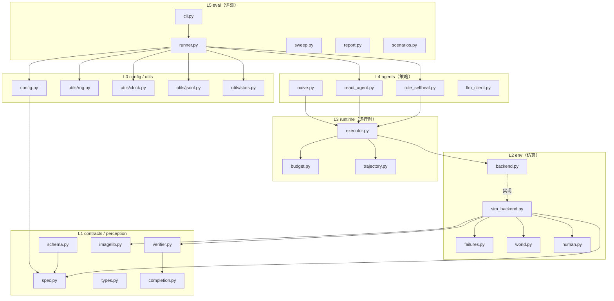
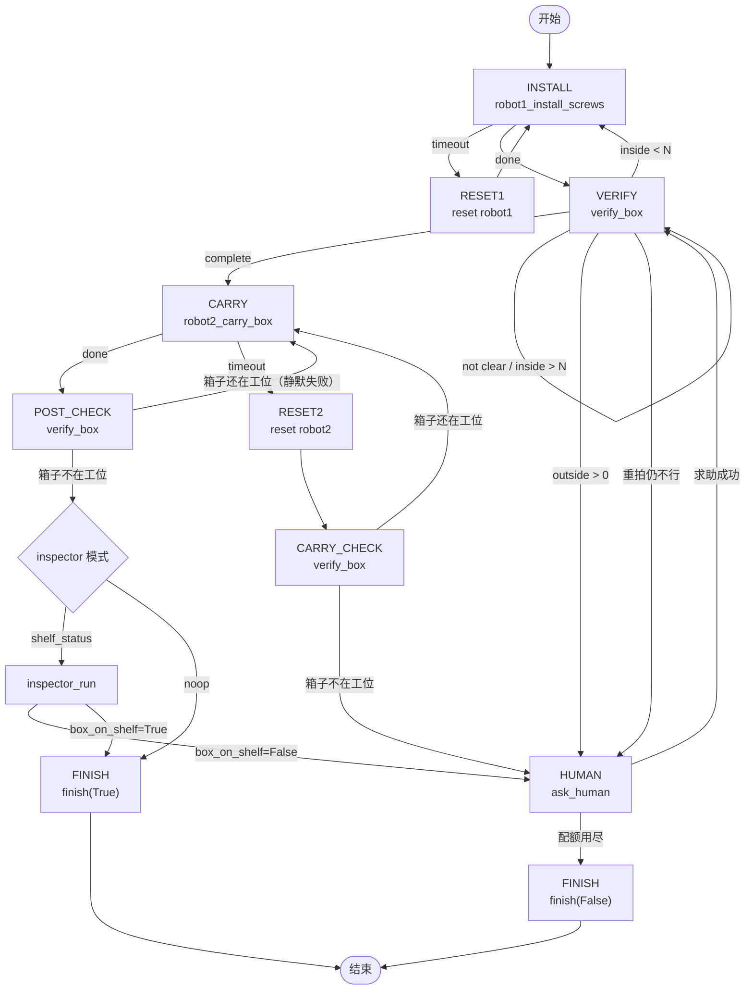

# shelf-agent · 螺丝装箱 → 搬运上架的仿真环境与异常自愈 agent

一个**纯 Python、离线可跑**的仿真环境（带可配置、可复现的故障注入），以及能在其中
**异常自愈**的 agent 骨架。

- 一号机器人（固定）把螺丝装进箱子：阻塞、不可中断，只返回 `done` / `timeout`。
- 一号机器人的头部相机能看到箱内，用来判断螺丝是否装满。
- 二号机器人（可移动）把箱子搬到货架：同样阻塞、不可中断。
- 巡检机器人占位；机器人可单独或整体 `reset`（回初始位姿），不会失败。

本仓库提供：确定性规则策略（baseline）、LLM ReAct agent（tool calling，测试里用脚本化
LLM）、评测工具（批量运行 / 指标 / 故障率扫描 / 出图）、以及扎实的离线 pytest 单测。

---

## 1. 快速开始

```bash
uv sync --extra dev          # 首次安装依赖（uv 不可用时见 §8）
uv run pytest -q             # 全量离线单测
uv run python -m shelf_agent.eval.cli demo --scenario stuck_once --show-truth
uv run python -m shelf_agent.eval.cli sweep --config configs/real_screw.yaml --seeds 100 \
    --failure-rates 0,0.05,0.1,0.2,0.3 --policies naive,rule_oracle,rule_noisy --out results/
```

---

## 2. 架构



**依赖方向只能向下**（`L5 → L4 → L3 → L2 → L1 → L0`），由 `tests/test_architecture.py`
用 AST 扫描强制执行：

- `env` / `contracts` / `perception` / `runtime` 不得 import 任何 LLM 或网络库；
- `agents` 不得 import `env.*`（只能经 `ToolExecutor` 与契约类型交互）；
- `contracts` 与 `perception` 同层互不 import（共享枚举因此下沉到 `utils/enums.py`）；
- 库代码里除 `llm_client.py` 的可注入退避外无 `time.sleep`；除 `cli.py` / `report.py` 外无 `print(`。

### 目录

```
shelf_agent/
├── pyproject.toml            # uv + src 布局；依赖仅 pyyaml / pillow / matplotlib / pytest 系
├── README.md
├── configs/
│   ├── real_screw.yaml       # 与真机对齐：1 箱 1 槽，工具无参数
│   └── extended.yaml         # [可] 2 箱 2 槽，带 box_id / slot_id
├── docs/
│   ├── assumptions.md        # 默认假设清单（A1–A26）
│   └── open_questions.md     # 开放问题 Q1–Q13
├── src/shelf_agent/
│   ├── config.py             # L0 配置加载 / 规范化哈希 / LLM 环境变量
│   ├── utils/                # L0 rng / clock / jsonl / stats / enums
│   ├── contracts/            # L1 spec / types / schema（契约校验 + OpenAI schema）
│   ├── perception/           # L1 completion / imagelib / verifier
│   ├── env/                  # L2 world / failures / human / backend / sim_backend
│   ├── runtime/              # L3 executor / budget / trajectory / episode / tool_env
│   ├── agents/               # L4 policy / naive / rule_selfheal / llm_client / react_agent / prompts
│   └── eval/                 # L5 runner / metrics / scenarios / sweep / report / cli
├── scripts/
│   └── live_probe.py         # 真实 LLM 探针（默认关闭，需显式开关）
└── tests/                    # 18 个测试文件，全部离线
```

---

## 3. 工具表

工具名用下划线（OpenAI 兼容 API 不允许函数名含点）；YAML 里保留 `lab_name` 与实验室名称对照。

| 工具名 | 实验室名 | 参数 | status | data | 说明 |
|---|---|---|---|---|---|
| `robot1_install_screws` | `robot1.install_screws` | 无 | `done` / `timeout` | 无 | 阻塞、不可中断；语义为「补装到目标数 N」 |
| `robot1_get_head_image` | `robot1.get_head_image` | 无 | `ok` | `image_id`, `path` | 只返回图像引用，1 s |
| `verify_box` | （本项目新增） | 无 | `ok` / `error` | `inside`, `outside`, `clear` | 拍照 → 验证器；箱子不在工位时 `error` |
| `robot2_carry_box` | `robot2.carry_box` | 无 | `done` / `timeout` | 无 | 阻塞、不可中断 |
| `reset` | `reset` | `robot ∈ {robot1, robot2, all}` | `ok` | 无 | 永不失败 |
| `inspector_run` | `inspector.run` | 无 | `done` | `box_on_shelf`（仅 `shelf_status`） | 默认 `noop` |
| `ask_human` | （本项目新增） | `question: str` | `ok` / `error` | `answer` | 有延迟与配额 |
| `finish` | （本项目新增） | `success: bool`, `summary: str` | `ok` | 无 | 结束 episode |

约定：`status` 取 `done`/`timeout`（实验室技能）、`ok`（其余）、`error`（守卫或前置违规，带
`error_code`）。**install / carry 的返回只有 status 与耗时，不带任何状态信息**——箱子到底搬没搬
成功，只能靠再验证一次来推断（这正是 `POST_CHECK` 存在的理由）。

---

## 4. 故障表

每个技能一条**独立随机流**（`sha256(f"{seed}:{stream}")` 派生），保证「换策略不会改变某技能
第 n 次调用的故障命运」。

| 故障类型 | 触发技能 | 语义 | 权重（默认） |
|---|---|---|---|
| `STUCK` | install | 装到一半卡住；robot1 → FAULT；返回 `timeout` | 0.4 |
| `INCOMPLETE` | install | 装少了（`progress` 颗）；返回 `done`（**看起来成功**） | 0.4 |
| `STRAY` | install | 最后一颗掉在箱外：箱内 N−1、箱外 1；返回 `done` | 0.2 |
| `TIMEOUT` | carry | robot2 → FAULT；箱子以概率 `p_lost` 变 `LOST`，否则留在工位；返回 `timeout` | 0.5 |
| `SILENT_FAIL` | carry | 返回 `done`，但箱子**仍在工位**（没有观察通道的失败） | 0.5 |

全局旋钮 `failures.rate = 0.15`（扫描时覆盖），`p_lost = 0.3`。

**脚本化注入**（测试与演示的基础）：

```python
FailureModel.scripted({
    "robot1_install_screws": ["STUCK", None, ("INCOMPLETE", {"progress": 2})],
    "robot2_carry_box": [("TIMEOUT", {"lost": False})],
})
```

按调用顺序消费，`None` 表示无事件，字符串是默认参数简写；脚本耗尽后该技能恢复正常。

---

## 5. 自愈流程



两条硬规则（有用例保证）：

1. **验证器没报告 complete，就绝不调用 carry**——`CARRY` 只能从一次「完整」的验证报告进入。
   `tests/test_policies.py` 用 200 seed × 3 个故障率 × 噪声验证器做 property 测试守住这条。
2. **任一限额耗尽 → 先求助人类（还有配额时），否则诚实 `finish(False)`**——宁可失败，也不谎报成功。

限额（`configs/real_screw.yaml` 的 `rule_policy` 段）：
`max_install_calls=6`、`max_resets_per_robot=3`、`max_unclear_retries=2`、
`max_carry_attempts=3`、`max_human_asks=2`。

### 命名场景（测试与演示共用）

| 场景 | 脚本 | 期望 | 实际调用序列 |
|---|---|---|---|
| `happy` | 无故障 | SUCCESS | install → verify → carry → verify → finish |
| `stuck_once` | install:[STUCK] | SUCCESS | install → reset → install → verify → carry → verify → finish |
| `incomplete_topup` | install:[INCOMPLETE(progress=3)] | SUCCESS | install → verify → install → verify → carry → verify → finish |
| `stray_needs_human` | install:[STRAY] | SUCCESS | install → verify → ask_human → verify → carry → verify → finish |
| `carry_timeout_reset` | carry:[TIMEOUT(lost=False)] | SUCCESS | install → verify → carry → reset → verify → carry → verify → finish |
| `carry_silent_fail_detected` | carry:[SILENT_FAIL] | SUCCESS | install → verify → carry → verify → carry → verify → finish |
| `lost_box_needs_human` | carry:[TIMEOUT(lost=True)] | SUCCESS | install → verify → carry → reset → verify → ask_human → verify → carry → verify → finish |
| `stuck_forever` | install:[STUCK]×10 | SAFE_ABORT | install → reset → install → reset → install → reset → install → ask_human → verify → install → ask_human → verify → install → finish |
| `verifier_false_positive` | install:[STRAY] + 验证器误报 complete | FALSE_FINISH（`unsafe_release=True`） | install → verify → carry → verify → finish |

---

## 6. 评测与指标

| Outcome | 条件 |
|---|---|
| `SUCCESS` | `finish(True)` 且真值成功（箱子在 SHELF 且 `inside == N and outside == 0`） |
| `FALSE_FINISH` | `finish(True)` 但真值未成功（**谎报成功**） |
| `SAFE_ABORT` | `finish(False)` 且真值未成功（**诚实失败**） |
| `MISSED_SUCCESS` | `finish(False)` 但真值成功（做对了却不敢报） |
| `ABORTED_BUDGET` | 预算硬停 |
| `MAX_STEPS` | 达到最大步数仍未 finish |
| `AGENT_ERROR` | agent 连续无有效 tool call |

每个 episode 的指标：`outcome`、`makespan_s`（虚拟时钟终值）、各工具调用数、`n_timeouts`、
`n_resets`、`n_unnecessary_resets`、`n_wasted_calls`、`n_human_asks`、`n_invalid_calls`、
`unsafe_release`。聚合时比例给 **Wilson 95% 置信区间**，均值给标准误；**同一组 seed 跑所有
策略**（配对比较，见 `summary.md` 末尾）。

---

## 7. 真实 sweep 结果

以下数字**全部来自实际运行**，命令与 seed 数如下（可复现）：

```bash
uv run python -m shelf_agent.eval.cli sweep --config configs/real_screw.yaml \
    --seeds 100 --failure-rates 0,0.05,0.1,0.2,0.3 \
    --policies naive,rule_oracle,rule_noisy --out results/
```

配置：`configs/real_screw.yaml`（N=6，故障权重 STUCK 0.4 / INCOMPLETE 0.4 / STRAY 0.2，
carry TIMEOUT 0.5 / SILENT_FAIL 0.5，`p_lost=0.3`）。每个故障率 × 每个策略共用**同一批
100 个 seed**（seed 0–99），因此下表是配对比较。

| failure_rate | policy | SUCCESS | FALSE_FINISH | SAFE_ABORT | SUCCESS 95% CI | unsafe_release | makespan_s (mean±se) | 求助次数 |
|---|---|---|---|---|---|---|---|---|
| 0.0 | naive | 100 | 0 | 0 | [0.963, 1.000] | 0.00 | 104.6±0.8 | 0.00 |
| 0.0 | rule_oracle | 100 | 0 | 0 | [0.963, 1.000] | 0.00 | 108.6±0.8 | 0.00 |
| 0.0 | rule_noisy | 100 | 0 | 0 | [0.963, 1.000] | 0.00 | 111.0±1.8 | 0.00 |
| 0.05 | naive | 86 | 14 | 0 | [0.779, 0.915] | 0.07 | 114.0±3.2 | 0.00 |
| 0.05 | rule_oracle | 100 | 0 | 0 | [0.963, 1.000] | 0.00 | 131.9±6.8 | 0.03 |
| 0.05 | rule_noisy | 100 | 0 | 0 | [0.963, 1.000] | 0.00 | 135.3±7.0 | 0.03 |
| 0.1 | naive | 78 | 22 | 0 | [0.689, 0.850] | 0.12 | 118.6±3.7 | 0.00 |
| 0.1 | rule_oracle | 100 | 0 | 0 | [0.963, 1.000] | 0.00 | 146.1±8.9 | 0.05 |
| 0.1 | rule_noisy | 100 | 0 | 0 | [0.963, 1.000] | 0.00 | 149.4±9.0 | 0.05 |
| 0.2 | naive | 68 | 32 | 0 | [0.583, 0.763] | 0.15 | 123.0±4.1 | 0.00 |
| 0.2 | rule_oracle | 100 | 0 | 0 | [0.963, 1.000] | 0.00 | 164.4±10.6 | 0.07 |
| 0.2 | rule_noisy | 100 | 0 | 0 | [0.963, 1.000] | 0.00 | 166.4±10.7 | 0.07 |
| 0.3 | naive | 52 | 48 | 0 | [0.423, 0.615] | 0.21 | 133.3±4.8 | 0.00 |
| 0.3 | rule_oracle | 99 | 0 | 1 | [0.946, 0.998] | 0.00 | 201.9±13.3 | 0.12 |
| 0.3 | rule_noisy | 99 | 0 | 1 | [0.946, 0.998] | 0.00 | 203.7±13.3 | 0.12 |

**配对比较**（同 seed，胜 = 左策略成功而右策略失败）：

| failure_rate | naive vs rule_noisy | rule_oracle vs rule_noisy |
|---|---|---|
| 0.0 | 胜 0 / 负 0 / 平 100 | 胜 0 / 负 0 / 平 100 |
| 0.05 | 胜 0 / 负 14 / 平 86 | 胜 0 / 负 0 / 平 100 |
| 0.1 | 胜 0 / 负 22 / 平 78 | 胜 0 / 负 0 / 平 100 |
| 0.2 | 胜 0 / 负 32 / 平 68 | 胜 0 / 负 0 / 平 100 |
| 0.3 | 胜 0 / 负 47 / 平 53 | 胜 0 / 负 0 / 平 100 |

**怎么读这张表**：

1. **自愈是有效的，而且差距随故障率拉开**：`naive`（不验证、不重试）的成功率从 100%
   掉到 52%，`rule` 则在 0.3 的故障率下仍有 99%。失败全部来自「不完整的箱子被搬到货架」
   ——也就是 `FALSE_FINISH`（谎报成功）与 `unsafe_release`（不安全放行）。
2. **代价是时间**：故障率 0.3 时 `rule` 的 makespan 从 ~109 s 涨到 ~202 s（reset 重试、
   重新验证、求助人类都要花仿真时间）。成功率换时间，这是自愈的账。
3. **验证器噪声几乎没有影响**：`rule_oracle` 与 `rule_noisy` 逐 seed 完全一致（100 个 seed
   全部打平）。原因很直接——策略**每次搬运前都重新验证**，单次误报被下一次验证挡住。
   这条结论只在「策略坚持验证」的前提下成立；`naive` 的 48 次 `FALSE_FINISH` 正是反面。
4. **唯一的 SAFE_ABORT**：故障率 0.3 时有 1 个 episode 限额耗尽后诚实放弃
   （`finish(False)`），符合「宁可失败也不谎报」的设定。
5. **图**：`results/success_vs_failure_rate.png`（双图：成功率带 Wilson 区间；
   `FALSE_FINISH` 与 `unsafe_release` 比例）。`results/summary.csv` 与 `results/summary.md`
   是同一批数字的机器可读版本。

> ⚠️ 这些结论建立在**拍的**故障参数上（见 §9 局限 1、2）。故障率旋钮扫的是「注入多频繁」，
> 不是「真机多容易坏」；换一组权重，naive 的下降曲线会变形，但「验证 + 重试 + 求助」这条
> 自愈链路的相对优势不会消失。

---

## 8. 运行方式与依赖

**依赖**：Python ≥ 3.10；第三方依赖仅 `pyyaml`、`pillow`、`matplotlib`（dev：`pytest`、
`pytest-cov`）。其余全部用标准库。

**用 uv**（推荐）：

```bash
uv sync --extra dev
uv run pytest -q
```

**uv 不可用时**退回 venv + pip：

```bash
python -m venv .venv
# Windows: .venv\Scripts\activate    POSIX: source .venv/bin/activate
python -m pip install -e ".[dev]"
python -m pytest -q
```

**CLI**（`python -m shelf_agent.eval.cli` 或安装后的 `shelf-agent`）：

```bash
shelf-agent list-scenarios
shelf-agent demo --scenario lost_box_needs_human --show-truth
shelf-agent sweep --config configs/real_screw.yaml --seeds 100 \
    --failure-rates 0,0.05,0.1,0.2,0.3 --policies naive,rule_oracle,rule_noisy --out results/
```

`sweep` 的产物：`episodes.jsonl`（每行一个 episode，含完整轨迹与真值轨迹）、`summary.csv`、
`summary.md`、`success_vs_failure_rate.png`（双图：成功率 / 误放行与不安全放行，含置信区间）。

**接真实 LLM**（Phase 3，需要网络与 key，**默认不执行、不进 CI**）：

```bash
export SHELF_AGENT_LLM_BASE_URL="http://127.0.0.1:3425/v1"   # 本机网关；也可用 Gemini 兼容端点或本地 vLLM
export SHELF_AGENT_LLM_MODEL="<GET /v1/models 里存在的模型 id>"
export SHELF_AGENT_LLM_API_KEY="local"
shelf-agent run --policy react --out results/react
```

三个环境变量**默认留空**，缺任何一个直接报错并指明该设哪一个；代码与默认配置里不写死任何
服务地址，API key 也不会出现在日志或轨迹里。各服务的官方文档为准（Magpie 网关的
`/v1/chat/completions` 与 `/v1/models` 路径以该网关自身说明为准）。

**live 探针**（与离线 pytest 完全分离，默认不联网）：

```bash
# 默认关闭：只打印用法就退出
python scripts/live_probe.py

# 显式打开才访问真实网关（CI 请勿打开）
set SHELF_AGENT_LIVE_PROBE=1
python scripts/live_probe.py --list-models
python scripts/live_probe.py --scenario happy
```

### [可] 扩展件

| 组件 | 位置 | 说明 |
|---|---|---|
| 多箱多槽配置 | `configs/extended.yaml` | 2 箱 2 槽，工具带 `box_id` / `slot_id`；槽位被占时自动换槽 |
| 真机照片图库 | `perception/imagelib.py` 的 `FolderImageLibrary` | 读 `labels.json`（`inside_count` / `outside_count` / `is_clear` / `note`），按真值匹配图片，匹配不上回退合成图 |
| gym 风格环境 | `runtime/tool_env.py` 的 `ToolEnv` | `reset(seed) -> (obs, info)`、`step(call) -> (obs, reward, terminated, truncated, info)`，为将来 RL 预留 |

---

## 9. 已知局限

1. **故障参数是拍的**：`rate = 0.15`、各故障权重、`p_lost = 0.3` 都没有真机统计支撑
   （见 `docs/open_questions.md` Q1）。现在只能靠 sweep 的敏感性分析来辩护「仿真是否真实」。
2. **验证器噪声参数同样没有实测来源**（Q6）：`p_inside_correct = 0.95` 与现有实测（Gemini
   3.5 Flash Lite 39/45 = 86.7%）量级对不上。
3. **只有 1 箱 1 槽**：`real_screw.yaml` 面向真机当前形态；多箱场景在 `extended.yaml`（[可]）。
4. **人类是脚本化的**：`ScriptedHuman` 只会机械地做三件事（散落归位、箱子放回、机器人复位），
   不理解问题内容；真人通道不在本期范围（Q11）。
5. **巡检机器人默认 `noop`**：真机能不能看货架还没确认（Q3）。若不能，`SILENT_FAIL` 只能靠
   「再拍一次头部相机」间接发现。
6. **不做训练**：本期没有 SFT / RL，轨迹 JSONL 是为将来的 SFT 准备的（`truth_snapshot` 已严格
   剥离，见 `tests/test_no_leak.py`）。
7. **不接真机**：仿真与真机共用 `SkillBackend` 接口，但真机实现不在本期（Q10）。
